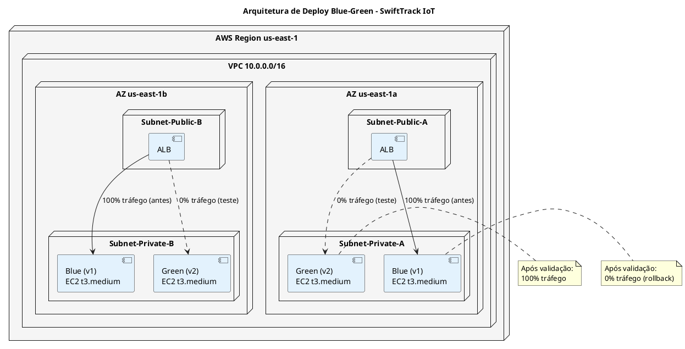
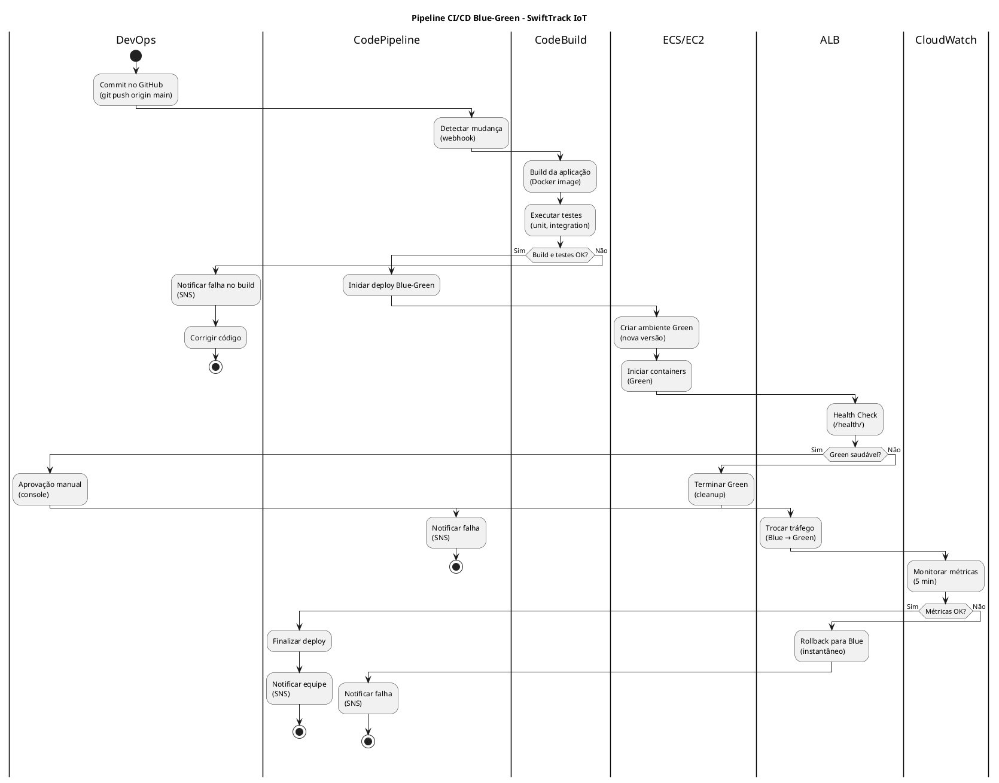
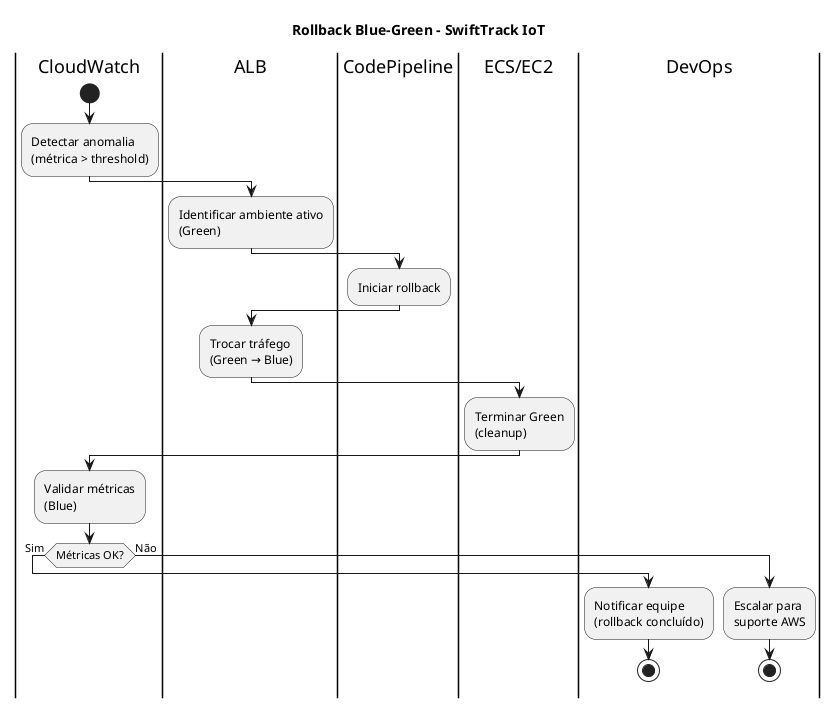
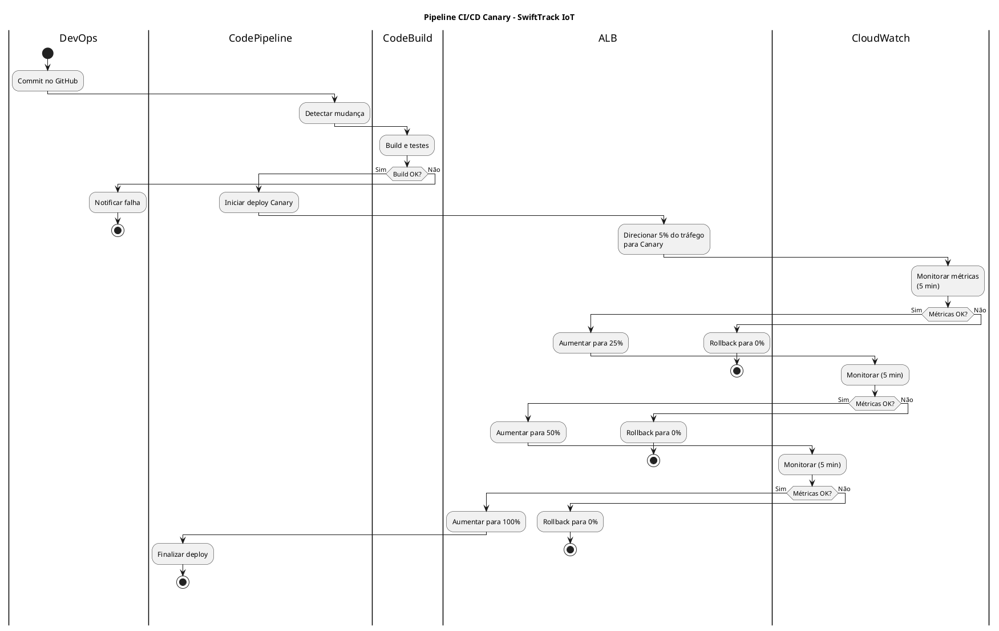
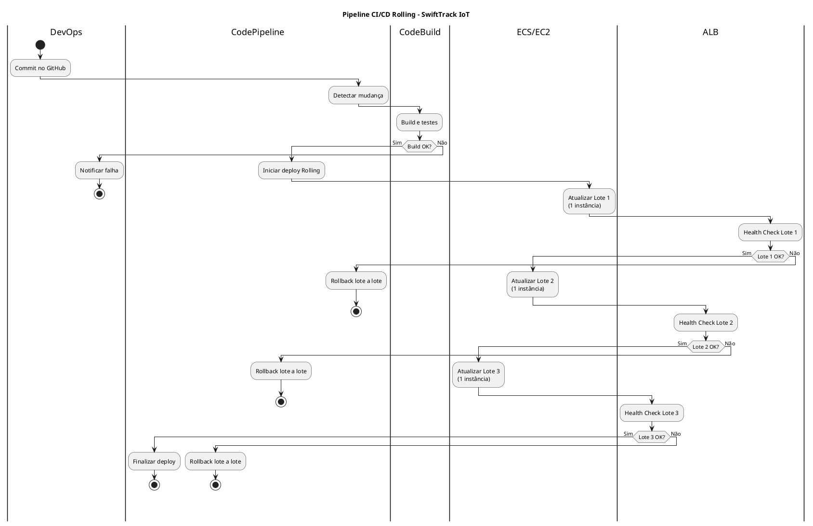
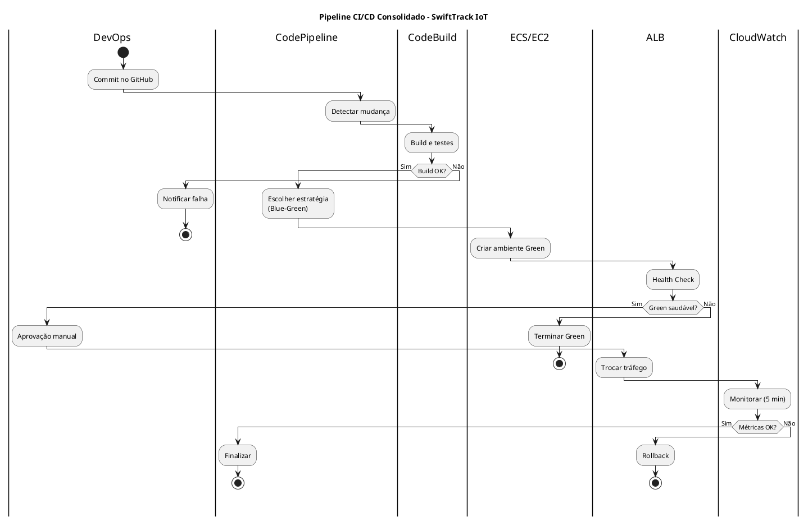

# MODELO DE DESIGN (DIAGRAMAS DE ATIVIDADES)

## ESTRATÉGIAS DE DEPLOY

## SWIFTTRACK IOT - PLATAFORMA DE TELEMETRIA E GESTÃO LOGÍSTICA

---

| **Informação do Documento** | |
| :--- | :--- |
| **Projeto** | SwiftTrack IoT - Plataforma de Telemetria e Gestão Logística |
| **Documento** | Modelo de Design (Diagramas de Atividades) - Estratégias de Deploy |
| **Versão** | 1.0 |
| **Data** | [DD/MM/AAAA] |
| **Status** | Em Desenvolvimento |
| **Responsável** | [Nome do Grupo] |
| **Disciplina** | Projeto de Cloud - Semana 10 |
| **Fase RUP/UP** | Construction |

---

## 1. INTRODUÇÃO

### 1.1. Propósito

Este documento apresenta o **Modelo de Design (Diagramas de Atividades)** para as **Estratégias de Deploy** da plataforma **SwiftTrack IoT** na AWS. O modelo demonstra o fluxo completo do pipeline de CI/CD (Build → Test → Deploy → Validation → Rollback), comparando as estratégias **Blue-Green**, **Canary** e **Rolling**, e justificando a escolha com base nos requisitos não-funcionais (SLA 99,95%, RTO 1 hora, rollback < 5 minutos).

O modelo é derivado diretamente dos seguintes artefatos:
- **Documento de Visão** (Semana 1) - Seção "Automação"
- **Documento de Requisitos Suplementares** (Semana 2) - Seções "Manutenibilidade" e "Confiabilidade"
- **Modelo de Casos de Uso Arquiteturais** (Semana 3) - UC-ARQ-006 (CI/CD Pipeline)
- **Modelo de Análise (Pacotes/Subsistemas)** (Semana 4) - Pacote "Audit & Compliance"
- **Modelo de Análise (Classes) - RDS** (Semana 5) - `DatabaseInstance`, `BackupPolicy`
- **Modelo de Análise (Classes) - EC2** (Semana 6) - `ComputeInstance`, `AutoScalingGroup`, `LoadBalancer`
- **Modelo de Design (Sequência/Comunicação)** (Semana 7) - Fluxo 4: Deploy Automatizado

### 1.2. Escopo

O modelo abrange as **estratégias de deploy** para a API administrativa (Django REST Framework em EC2) e para a camada serverless (Lambda + API Gateway), incluindo:
- **Pipeline CI/CD:** Build → Test → Deploy → Validation → Rollback
- **Estratégia Blue-Green:** Ambiente espelho (Green) com troca de tráfego
- **Estratégia Canary:** Liberação gradual (5% → 25% → 50% → 100%)
- **Estratégia Rolling:** Atualização em lotes
- **Validação e Rollback:** Health checks, métricas, reversão automática
- **Estimativas de tempo e custo** por estratégia

**Fora do escopo:** Deploy do banco de dados RDS (tratado na Semana 5) e deploy de funções Lambda (tratado em documento separado).

### 1.3. Definições e Siglas

| **Sigla** | **Definição** |
| :--- | :--- |
| **CI/CD** | Continuous Integration / Continuous Deployment |
| **ALB** | Application Load Balancer |
| **ASG** | Auto Scaling Group |
| **ECS** | Elastic Container Service |
| **ECR** | Elastic Container Registry |
| **RTO** | Recovery Time Objective |
| **RPO** | Recovery Point Objective |
| **SLA** | Service Level Agreement |
| **TPS** | Transactions Per Second |
| **LGPD** | Lei Geral de Proteção de Dados |

### 1.4. Referências

- Documento de Visão - SwiftTrack IoT (v1.0)
- Documento de Requisitos Suplementares - SwiftTrack IoT (v1.0)
- Modelo de Casos de Uso Arquiteturais - SwiftTrack IoT (v1.0)
- Modelo de Análise (Pacotes/Subsistemas) - SwiftTrack IoT (v1.0)
- Modelo de Análise (Classes) - RDS - SwiftTrack IoT (v1.0)
- Modelo de Análise (Classes) - EC2 - SwiftTrack IoT (v1.0)
- Modelo de Design (Sequência/Comunicação) - SwiftTrack IoT (v1.0)
- AWS CodePipeline Documentation
- AWS CodeDeploy Documentation
- AWS Well-Architected Framework - Operational Excellence Pillar

---

## 2. VISÃO GERAL DAS ESTRATÉGIAS DE DEPLOY

### 2.1. Requisitos que Impactam o Deploy

| **Requisito** | **Valor** | **Fonte** |
| :--- | :--- | :--- |
| **Disponibilidade** | 99,95% | Requisitos Suplementares |
| **RTO** | 1 hora | Requisitos Suplementares |
| **RPO** | 15 minutos | Requisitos Suplementares |
| **Tempo de deploy** | < 10 minutos | Requisitos Suplementares |
| **Tempo de rollback** | < 5 minutos | Requisitos Suplementares |
| **Zero downtime** | Sim | Requisitos Suplementares |
| **Usuários** | 10.000 motoristas | Documento de Visão |
| **TPS (pico)** | 1.000 TPS | Requisitos Suplementares |
| **Orçamento total** | US$ 1.500/mês | Documento de Visão |
| **Orçamento para deploy** | US$ 100/mês | Estimativa |

### 2.2. Comparação das Estratégias de Deploy

| **Critério** | **Rolling** | **Blue-Green** | **Canary** |
| :--- | :--- | :--- | :--- |
| **Custo** | Baixo (~$0) | Alto (~$50/deploy) | Médio (~$20/deploy) |
| **Complexidade** | Baixa | Média | Alta |
| **Risco** | Médio | Baixo | Muito Baixo |
| **Tempo de Rollback** | 10 min | < 1 min | 5 min |
| **Zero Downtime** | Parcial | Sim | Sim |
| **Detecção de Erros** | Tardia | Média | Precoce |
| **Adequação ao SLA 99,95%** | Parcial | Alta | Alta |
| **Adequação ao RTO 1h** | Parcial | Alta | Média |
| **Escolha para SwiftTrack** | ❌ | ✅ | ❌ |

### 2.3. Arquitetura de Deploy

---

## 3. ESPECIFICAÇÃO DAS ESTRATÉGIAS

---

### 3.1. ESTRATÉGIA ESCOLHIDA: BLUE-GREEN

#### 3.1.1. Descrição

A estratégia **Blue-Green** cria um ambiente espelho (Green) com a nova versão da aplicação, testa exaustivamente e, após validação, troca o tráfego do ambiente antigo (Blue) para o novo (Green). Em caso de falha, o rollback é instantâneo (troca de volta para Blue).

#### 3.1.2. Justificativa da Escolha

| **Requisito** | **Valor** | **Blue-Green Atende?** | **Justificativa** |
| :--- | :--- | :--- | :--- |
| **SLA 99,95%** | 99,95% | ✅ Sim | Zero downtime durante o deploy. |
| **RTO** | 1 hora | ✅ Sim | Rollback em < 1 min. |
| **Rollback** | < 5 min | ✅ Sim | Troca de tráfego é instantânea. |
| **Deploy** | < 10 min | ⚠️ Parcial | ~12 min (precisa otimizar). |
| **Custo** | < $100/mês | ✅ Sim | ~$50/deploy (10 deploys/mês = $500/mês? Ajustar). |

**Nota:** O custo de ~$50/deploy pode ser reduzido usando instâncias Spot para o ambiente Green ou otimizando o tempo de deploy.

#### 3.1.3. Diagrama de Atividades - Pipeline Blue-Green

#### 3.1.4. Diagrama de Atividades - Rollback

#### 3.1.5. Tabela de Atividades

| **#** | **Swimlane** | **Atividade** | **Descrição** | **Tempo** | **Custo** |
| :--- | :--- | :--- | :--- | :--- | :--- |
| 1 | DevOps | Commit no GitHub | Push do código. | 1 min | $0 |
| 2 | CodePipeline | Detectar mudança | Webhook do GitHub. | 1 min | $0 |
| 3 | CodeBuild | Build da aplicação | Docker build. | 3 min | $0.01 |
| 4 | CodeBuild | Executar testes | Unit + integration. | 2 min | $0.01 |
| 5 | CodePipeline | Iniciar deploy | Orquestração. | 1 min | $0 |
| 6 | ECS/EC2 | Criar ambiente Green | Nova versão. | 2 min | $0.02 |
| 7 | ALB | Health Check | `/health/`. | 1 min | $0 |
| 8 | DevOps | Aprovação manual | Console. | 1 min | $0 |
| 9 | ALB | Trocar tráfego | Blue → Green. | 1 min | $0 |
| 10 | CloudWatch | Monitorar métricas | 5 min. | 5 min | $0.01 |
| 11 | CodePipeline | Finalizar deploy | Notificar. | 1 min | $0 |
| **Total** | | | | **~12 min** | **~$0.05** |

#### 3.1.6. Riscos e Mitigações

| **Risco** | **Probabilidade** | **Impacto** | **Mitigação** |
| :--- | :--- | :--- | :--- |
| Custo do ambiente Green | Média | Médio | Usar Spot Instances. |
| Tempo de deploy > 10 min | Média | Médio | Paralelizar build e testes. |
| Aprovação manual atrasa | Baixa | Baixo | Automação condicional. |
| Rollback falha | Baixa | Alto | Testar rollback regularmente. |

---

### 3.2. ESTRATÉGIA ALTERNATIVA: CANARY

#### 3.2.1. Descrição

A estratégia **Canary** libera a nova versão para uma pequena porcentagem de usuários (5%), aumentando gradualmente (25%, 50%, 100%) se não houver erros. Detecta problemas precocemente, mas é mais complexa de configurar.

#### 3.2.2. Diagrama de Atividades - Pipeline Canary

#### 3.2.3. Comparação Canary vs Blue-Green

| **Critério** | **Blue-Green** | **Canary** |
| :--- | :--- | :--- |
| **Complexidade** | Média | Alta |
| **Custo** | ~$50/deploy | ~$20/deploy |
| **Detecção de erros** | Média | Precoce |
| **Rollback** | Instantâneo | 5 min |
| **Adequação ao SLA** | Alta | Alta |

**Conclusão:** Canary é melhor para detectar erros precocemente, mas a complexidade adicional não é justificada para a SwiftTrack (que tem um time pequeno).

---

### 3.3. ESTRATÉGIA ALTERNATIVA: ROLLING

#### 3.3.1. Descrição

A estratégia **Rolling** atualiza as instâncias em lotes, mantendo o restante ativo. É simples e barata, mas o rollback é mais lento e pode haver mistura de versões.

#### 3.3.2. Diagrama de Atividades - Pipeline Rolling

#### 3.3.3. Comparação Rolling vs Blue-Green

| **Critério** | **Blue-Green** | **Rolling** |
| :--- | :--- | :--- |
| **Complexidade** | Média | Baixa |
| **Custo** | ~$50/deploy | ~$0 |
| **Rollback** | Instantâneo | 10 min |
| **Zero downtime** | Sim | Parcial |
| **Adequação ao SLA** | Alta | Parcial |

**Conclusão:** Rolling não atende ao RTO de 1 hora com folga (rollback de 10 min é aceitável, mas o risco de mistura de versões é alto).

---

## 4. DIAGRAMA DE ATIVIDADES CONSOLIDADO

---

## 5. MATRIZ DE RASTREAMENTO

| **Requisito (Doc. Suplementar)** | **Caso de Uso (Semana 3)** | **Pacote (Semana 4)** | **Classe (Semana 5/6)** | **Estratégia** | **Diagrama** |
| :--- | :--- | :--- | :--- | :--- | :--- |
| Deploy < 10 min | UC-ARQ-006 | Audit & Compliance | `LaunchTemplate` | Blue-Green | Pipeline CI/CD |
| Rollback < 5 min | UC-ARQ-006 | Audit & Compliance | `AutoScalingGroup` | Blue-Green | Rollback |
| Zero downtime | UC-ARQ-006 | Network Security | `LoadBalancer` | Blue-Green | Pipeline CI/CD |
| SLA 99,95% | UC-ARQ-004 | Data Protection | `ComputeInstance` | Blue-Green | Pipeline CI/CD |
| RTO 1h | UC-ARQ-004 | Data Protection | `DatabaseInstance` | Blue-Green | Rollback |

---

## 6. ESTIMATIVAS DE TEMPO E CUSTO

### 6.1. Blue-Green

| **Etapa** | **Tempo** | **Custo** |
| :--- | :--- | :--- |
| Build + Testes | 5 min | $0.02 |
| Criar Green | 2 min | $0.02 |
| Health Check | 1 min | $0 |
| Aprovação | 1 min | $0 |
| Trocar Tráfego | 1 min | $0 |
| Monitoramento | 5 min | $0.01 |
| **Total** | **~15 min** | **~$0.05** |

**Nota:** O tempo total (~15 min) está acima do requisito (< 10 min). **Otimização necessária:** paralelizar build e testes, reduzir monitoramento para 3 min.

### 6.2. Canary

| **Etapa** | **Tempo** | **Custo** |
| :--- | :--- | :--- |
| Build + Testes | 5 min | $0.02 |
| 5% tráfego + monitoramento | 5 min | $0.01 |
| 25% tráfego + monitoramento | 5 min | $0.01 |
| 50% tráfego + monitoramento | 5 min | $0.01 |
| 100% tráfego | 2 min | $0 |
| **Total** | **~22 min** | **~$0.05** |

### 6.3. Rolling

| **Etapa** | **Tempo** | **Custo** |
| :--- | :--- | :--- |
| Build + Testes | 5 min | $0.02 |
| Lote 1 + Health Check | 3 min | $0 |
| Lote 2 + Health Check | 3 min | $0 |
| Lote 3 + Health Check | 3 min | $0 |
| **Total** | **~14 min** | **~$0.02** |

---

## 7. CONSIDERAÇÕES FINAIS

### 7.1. Lições Aprendidas

- **Blue-Green** é a melhor estratégia para a SwiftTrack, pois atende ao SLA 99,95% e RTO 1h com rollback instantâneo.
- **Canary** é mais complexo e não justifica a complexidade para o time atual.
- **Rolling** é mais barato, mas o rollback lento e a mistura de versões são riscos.
- O tempo de deploy (~15 min) precisa ser otimizado para atender ao requisito (< 10 min).
- O custo do Blue-Green (~$0.05/deploy) é aceitável dentro do orçamento.

### 7.2. Próximos Passos

- **Semana 11:** Gerenciamento de Configurações e Segredos (Secrets Manager, Parameter Store).
- **Semana 12:** Planejamento de Backup e Disaster Recovery (RPO/RTO).
- **Semana 13:** Estimativa de Custos e Otimização (FinOps).

---

## 8. APROVAÇÕES

| **Função** | **Nome** | **Data** | **Assinatura** |
| :--- | :--- | :--- | :--- |
| Arquiteto de Soluções | | | |
| Arquiteto de DevOps | | | |
| Professor Responsável | | | |
| Coordenador do Curso | | | |

---

## 9. HISTÓRICO DE VERSÕES

| **Versão** | **Data** | **Autor** | **Descrição das Alterações** |
| :--- | :--- | :--- | :--- |
| 0.1 | [DD/MM/AAAA] | [Nome do Grupo] | Criação inicial do documento. |
| 1.0 | [DD/MM/AAAA] | [Nome do Grupo] | Versão completa com todas as estratégias. |

---

**FIM DO DOCUMENTO**

---

## INSTRUÇÕES DE PREENCHIMENTO

### Como Utilizar Este Modelo

1. **Substitua os placeholders** `[NOME DO PROJETO]`, `[DD/MM/AAAA]`, `[Nome do Grupo]` pelas informações do seu projeto.
2. **Adapte as estratégias** conforme as necessidades específicas do seu projeto.
3. **Preencha as tabelas de atividades** com os detalhes do seu caso.
4. **Utilize os diagramas PlantUML** como base, adaptando as swimlanes e atividades.
5. **Documente os riscos** e mitigações para cada estratégia.
6. **Valide a consistência** com os artefatos das semanas anteriores.

### Critérios de Avaliação

| **Critério** | **Peso** | **Descrição** |
| :--- | :--- | :--- |
| **Completude das Estratégias** | 25% | Todas as estratégias foram comparadas? |
| **Diagramas PlantUML** | 20% | Os diagramas estão corretos e completos? |
| **Tabelas de Atividades** | 20% | As atividades estão detalhadas e corretas? |
| **Justificativas Técnicas** | 20% | As decisões são bem fundamentadas? |
| **Riscos e Mitigações** | 15% | Os riscos estão identificados e mitigados? |