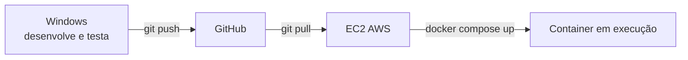

## Django API com Docker + SQLite na EC2 Ubuntu 24.04 LTS

## Objetivo

Criar uma API Django e executá-la em um container Docker usando SQLite, primeiro localmente e depois em uma instância EC2 com Ubuntu Server 24.04 LTS. Este é o ponto de partida: o roteiro seguinte ([djangopgdocker.md](./djangopgdocker.md)) evolui o mesmo projeto para PostgreSQL.

Resultado: endpoint `http://localhost:8000/api/tarefas/` funcionando localmente e `http://<IP_PUBLICO_EC2>:8000/api/tarefas/` acessível na EC2, com dados persistidos em um volume Docker.

## Pré-requisitos

- Windows: Python 3.12+, Docker Desktop (`docker compose version`) e Git
- Conta no GitHub e um repositório criado para o projeto
- Conta AWS e uma instância EC2 com Ubuntu Server 24.04 LTS, endereço IPv4 público e acesso SSH
- No Security Group da EC2, permitir SSH (TCP 22) somente a partir do seu IP; permitir TCP 8000 a partir dos endereços que precisarão acessar a API

## Fluxo de trabalho

| Etapa | Onde | O que fazer |
|---|---|---|
| 1. Desenvolver | **Windows** | Partes 1 a 4: criar o projeto, escrever o código, subir o Docker e testar localmente |
| 2. Versionar | **Windows → GitHub** | Parte 5: `git commit` e `git push` |
| 3. Preparar e sincronizar | **Ubuntu EC2** | Partes 6 e 7: conectar por SSH, instalar Docker e obter o código com Git |
| 4. Deploy | **Ubuntu EC2 (Docker)** | Parte 7: `docker compose up -d --build` e teste pelo IP público |



Regra: o código é alterado **somente no Windows**. A EC2 apenas recebe as mudanças via Git e executa o deploy.

---

## Parte 1 - Criar o projeto (Windows)

```bash
mkdir minha-api && cd minha-api
python -m venv .venv
# Windows: .venv\Scripts\activate   |  Linux/Mac: source .venv/bin/activate
pip install django djangorestframework gunicorn
pip freeze > requirements.txt
django-admin startproject config .
python manage.py startapp tarefas
```

No Windows, salve o conteúdo abaixo como `criar-projeto.ps1` na pasta onde deseja criar o projeto e execute-o no PowerShell. O script usa diretamente o Python do ambiente virtual, sem precisar ativá-lo:

```powershell
$ErrorActionPreference = "Stop"

New-Item -ItemType Directory -Force -Path "minha-api" | Out-Null
Set-Location "minha-api"

python -m venv .venv
$python = ".\.venv\Scripts\python.exe"
& $python -m pip install django djangorestframework gunicorn
& $python -m pip freeze | Set-Content -Encoding ascii requirements.txt
& ".\.venv\Scripts\django-admin.exe" startproject config .
& $python manage.py startapp tarefas
```

Execute com ` .\criar-projeto.ps1` (sem o espaço inicial). Se a política de execução bloquear o script, use `powershell -ExecutionPolicy Bypass -File .\criar-projeto.ps1`.


## Parte 2 - Código da API (Windows)

### `config/settings.py`

Registre os apps, aceite requisições externas e deixe o caminho do SQLite configurável (isso facilita a troca por Postgres depois):

```python
import os

ALLOWED_HOSTS = os.environ.get("DJANGO_ALLOWED_HOSTS", "*").split(",")

INSTALLED_APPS = [
    # ... apps padrão ...
    "rest_framework",
    "tarefas",
]

DATABASES = {
    "default": {
        "ENGINE": "django.db.backends.sqlite3",
        "NAME": os.environ.get("SQLITE_PATH", BASE_DIR / "db.sqlite3"),
    }
}
```

### `tarefas/models.py`

```python
from django.db import models


class Tarefa(models.Model):
    titulo = models.CharField(max_length=200)
    concluida = models.BooleanField(default=False)
    criada_em = models.DateTimeField(auto_now_add=True)

    def __str__(self):
        return self.titulo
```

### `tarefas/serializers.py` (novo arquivo)

```python
from rest_framework import serializers
from .models import Tarefa


class TarefaSerializer(serializers.ModelSerializer):
    class Meta:
        model = Tarefa
        fields = "__all__"
```

### `tarefas/views.py`

```python
from rest_framework import viewsets
from .models import Tarefa
from .serializers import TarefaSerializer


class TarefaViewSet(viewsets.ModelViewSet):
    queryset = Tarefa.objects.all().order_by("-criada_em")
    serializer_class = TarefaSerializer
```

### `config/urls.py`

```python
from django.contrib import admin
from django.urls import include, path
from rest_framework.routers import DefaultRouter
from tarefas.views import TarefaViewSet

router = DefaultRouter()
router.register("tarefas", TarefaViewSet)

urlpatterns = [
    path("admin/", admin.site.urls),
    path("api/", include(router.urls)),
]
```

Gere a migração (será versionada no Git):

```bash
python manage.py makemigrations tarefas
```

---

## Parte 3 - Docker (Windows)

### O que é um Dockerfile?

Um Dockerfile é um arquivo de texto com instruções para construir uma imagem Docker. Ele descreve, em etapas, o ambiente e os arquivos necessários para executar a aplicação, como a imagem base, a instalação de dependências e o comando de inicialização. A imagem resultante pode ser usada para criar containers de forma reproduzível.

### `Dockerfile`

```dockerfile
FROM python:3.12-slim
ENV PYTHONDONTWRITEBYTECODE=1 PYTHONUNBUFFERED=1
WORKDIR /app
COPY requirements.txt .
RUN pip install --no-cache-dir -r requirements.txt
COPY . .
CMD ["sh", "-c", "python manage.py migrate --noinput && gunicorn config.wsgi:application --bind 0.0.0.0:8000"]
```

#### Explicação do Dockerfile

- `FROM python:3.12-slim`: inicia a imagem usando uma versão compacta do Python 3.12.
- `ENV PYTHONDONTWRITEBYTECODE=1 PYTHONUNBUFFERED=1`: evita a criação de arquivos `.pyc` e envia os logs do Python sem atraso.
- `WORKDIR /app`: define `/app` como diretório de trabalho dentro do container.
- `COPY requirements.txt .`: copia o arquivo de dependências para esse diretório.
- `RUN pip install --no-cache-dir -r requirements.txt`: instala as dependências sem manter o cache do pip na imagem.
- `COPY . .`: copia o restante do projeto para `/app`.
- `CMD [...]`: configura o comando executado ao iniciar o container. Ele aplica as migrações e, se isso terminar sem erro, inicia o Gunicorn na porta `8000`. `0.0.0.0` permite conexões de fora do container.

O `migrate` roda ao iniciar, criando o arquivo do SQLite se ele não existir.

### `.dockerignore`

```
.venv/
__pycache__/
*.pyc
db.sqlite3
.git/
```

### `.gitignore`

```
.venv/
__pycache__/
*.pyc
db.sqlite3
```

### `docker-compose.yml`

O arquivo `docker-compose.yml` descreve como iniciar e configurar os serviços de uma aplicação com o Docker Compose. Ele reúne em um só lugar informações como a forma de construir a imagem, as portas a publicar, as variáveis de ambiente e os volumes. Dessa forma, o ambiente pode ser iniciado de maneira consistente com um comando, como `docker compose up`.


```yaml
services:
  web:
    build: .
    ports:
      - "8000:8000"
    environment:
      SQLITE_PATH: /data/db.sqlite3
    volumes:
      - sqlitedata:/data

volumes:
  sqlitedata:
```

- `services`: declara os serviços da aplicação; aqui, o serviço `web` executa a API.
- `build: .`: constrói a imagem usando o Dockerfile do diretório atual.
- `ports`: permite acessar a porta `8000` do container pela porta `8000` do computador.
- `environment`: informa à aplicação o caminho do banco SQLite.
- `volumes`: monta o volume persistente `sqlitedata` no diretório `/data` do container.

O volume `sqlitedata` guarda o arquivo `.sqlite3` fora do container; sem ele, os dados seriam perdidos a cada recriação.

---

## Parte 4 - Executar e testar localmente (Windows)

Execute no PowerShell, na pasta `minha-api`, com o Docker Desktop em execução. Só avance para a Parte 5 depois que a API responder corretamente aqui.

```bash

docker compose up -d --build
docker compose logs -f web
```

`docker compose logs -f web` exibe os logs do serviço `web` e continua acompanhando novas mensagens (`-f`). Pressione `Ctrl+C` para parar de acompanhar os logs; o container continuará em execução.

`docker compose up -d --build` constrói ou atualiza a imagem da aplicação e inicia os serviços em segundo plano (`-d`).

```bash
curl http://localhost:8000/api/tarefas/
curl -X POST http://localhost:8000/api/tarefas/ -H "Content-Type: application/json" -d '{"titulo":"Estudar Docker"}'
curl http://localhost:8000/api/tarefas/
```

No PowerShell, use `curl.exe` ou `Invoke-RestMethod`. Também é possível abrir `http://localhost:8000/api/tarefas/` no navegador.

### Testar a persistência

```bash
docker compose down
docker compose up -d
curl http://localhost:8000/api/tarefas/
```

A tarefa criada deve continuar na lista.

### (Opcional) Admin

```bash
docker compose exec web python manage.py createsuperuser
```

Acesse `http://localhost:8000/admin/`. Sem arquivos estáticos configurados, o admin aparece sem estilo; isso é esperado neste roteiro inicial.

Ao terminar os testes, pare o ambiente local com `docker compose down`.

---

## Parte 5 - Sincronizar com o GitHub (Windows → GitHub)

No PowerShell, na pasta `minha-api`:

```powershell
git init
git add .
git commit -m "API Django com Docker e SQLite"
git branch -M main
git remote add origin https://github.com/<usuario>/<repositorio>.git
git push -u origin main
```

Confira no GitHub que `Dockerfile`, `docker-compose.yml`, `requirements.txt`, `manage.py` e `tarefas/migrations/` estão presentes e que `.venv/` e `db.sqlite3` não foram enviados.

Em alterações futuras, repita apenas:

```powershell
git add .
git commit -m "descrição da mudança"
git push
```

---

## Parte 6 - Preparar e sincronizar com a EC2 Ubuntu (GitHub → EC2)

### Criar a instância

No console da AWS, crie uma instância com as seguintes opções:

- **AMI:** Ubuntu Server 24.04 LTS (64-bit x86 ou Arm, conforme o tipo de instância)
- **Par de chaves:** selecione ou crie uma chave `.pem` e guarde-a em local seguro
- **Security Group:** permita SSH (TCP `22`) somente a partir do seu IP. Para testar a API, permita TCP `8000` a partir do seu IP ou da rede que deve acessá-la; evite `0.0.0.0/0` em ambientes não controlados
- **Endereço público:** atribua um IPv4 público ou Elastic IP para conectar e testar a API

### Conectar por SSH (Windows)

No PowerShell, substitua o caminho da chave e o IP público pelos valores da sua instância. O usuário padrão da imagem Ubuntu da AWS é `ubuntu`:

```powershell
ssh -i "C:\caminho\para\chave.pem" ubuntu@<IP_PUBLICO_EC2>
```

Se o SSH recusar a chave por permissões excessivas, restrinja as permissões do arquivo `.pem` nas propriedades de segurança do Windows ou conecte-se usando um terminal Linux/WSL com permissões de arquivo adequadas.

Na **EC2 Ubuntu** (`ubuntu`), atualize os pacotes, instale Git e obtenha o código:

```bash
sudo apt update
sudo apt upgrade -y
sudo apt install -y git

# primeira vez
git clone https://github.com/<usuario>/<repositorio>.git
cd <repositorio>

# próximas vezes
cd <repositorio>
git pull
```

Se o repositório for privado, configure uma deploy key SSH na EC2 ou use outro método seguro de autenticação. Não coloque tokens no URL do repositório nem os salve no histórico do shell.

---

## Parte 7 - Deploy com Docker (Ubuntu 24.04 na EC2)

### I. Instalar Docker Engine, Compose e Buildx

O Ubuntu 24.04 usa `apt`. Os passos abaixo configuram o repositório oficial do Docker e instalam o Engine, o plugin Compose e o Buildx:

```bash
# Instalar dependências e adicionar a chave GPG do Docker
sudo apt update
# Instalar dependências e adicionar a chave GPG do Docker
sudo apt install -y ca-certificates curl
# Adicionar o repositório oficial do Docker
sudo install -m 0755 -d /etc/apt/keyrings
# Baixar a chave GPG do Docker e salvá-la
sudo curl -fsSL https://download.docker.com/linux/ubuntu/gpg \
  -o /etc/apt/keyrings/docker.asc
# Ajustar permissões da chave
sudo chmod a+r /etc/apt/keyrings/docker.asc
# Adicionar o repositório do Docker à lista de fontes do apt
echo \
  "deb [arch=$(dpkg --print-architecture) signed-by=/etc/apt/keyrings/docker.asc] https://download.docker.com/linux/ubuntu \
  $(. /etc/os-release && echo "${UBUNTU_CODENAME:-$VERSION_CODENAME}") stable" | \
  sudo tee /etc/apt/sources.list.d/docker.list > /dev/null
# Atualizar a lista de pacotes e instalar o Docker
sudo apt update
# Instalar o Docker Engine, CLI, containerd, Buildx e Compose
sudo apt install -y docker-ce docker-ce-cli containerd.io \
  docker-buildx-plugin docker-compose-plugin
# Habilitar o serviço Docker para iniciar automaticamente e iniciar o serviço agora
sudo systemctl enable --now docker
```

### II. Permitir que o usuário use Docker sem `sudo`

Adicione o usuário padrão `ubuntu` ao grupo `docker`:

```bash
sudo usermod -aG docker ubuntu
```

Saia da sessão SSH e conecte-se novamente para aplicar a associação ao grupo. Até reconectar, execute os comandos Docker com `sudo`.

> **Atenção:** o grupo `docker` concede privilégios equivalentes aos de `root`. Adicione somente usuários confiáveis. Se preferir não conceder essa permissão, mantenha `sudo` antes dos comandos Docker.

### III. Verificar a instalação

Depois de reconectar por SSH (ou usando `sudo` antes de entrar no grupo):

```bash
docker --version
docker compose version
docker buildx version
```

### IV. Construir e iniciar os serviços

Antes do primeiro deploy com arquivos estáticos, faça estas alterações no projeto **no Windows** e envie-as ao GitHub. A EC2 apenas recebe o código com `git pull`.

1. Em `requirements.txt`, adicione:

   ```
   whitenoise
   ```

2. Em `config/settings.py`, configure a pasta de destino dos arquivos coletados:

   ```python
   STATIC_URL = "/static/"
   STATIC_ROOT = BASE_DIR / "staticfiles"
   ```

   Na lista `MIDDLEWARE`, adicione esta linha logo depois de `SecurityMiddleware`:

   ```python
   "whitenoise.middleware.WhiteNoiseMiddleware",
   ```

3. No `Dockerfile`, faça o container coletar os arquivos antes de iniciar o Gunicorn:

   ```dockerfile
   CMD ["sh", "-c", "python manage.py collectstatic --noinput && python manage.py migrate --noinput && gunicorn config.wsgi:application --bind 0.0.0.0:8000"]
   ```

   Nos templates, use `` e referências `` para gerar as URLs dos arquivos.

Depois de enviar essas alterações ao GitHub e executar `git pull` na EC2, construa a imagem novamente. Na pasta do projeto, execute:

```bash
docker compose up -d --build
docker compose ps
docker compose logs -f web
```

`docker compose logs -f web` acompanha os logs; pressione `Ctrl+C` para parar de acompanhá-los sem parar o container.
O `collectstatic` copia os arquivos das aplicações Django, incluindo os do admin, para `staticfiles`; o WhiteNoise os serve pelo próprio container web.

Teste de uma máquina autorizada no Security Group:

```powershell
curl.exe http://<IP_PUBLICO_EC2>:8000/api/tarefas/
```

Para restringir os hosts aceitos pelo Django, defina `DJANGO_ALLOWED_HOSTS` no Compose (por exemplo, o IP público da EC2) em vez de usar `*`. Restrinja também a origem da regra TCP `8000` no Security Group. A porta da aplicação neste roteiro não usa HTTPS; não a exponha publicamente para dados sensíveis.

### Ciclo de atualização

1. **Windows**: altere o código e teste:

```bash
docker compose up -d --build
git push
```

2. **Ubuntu EC2**:

```bash
git pull
docker compose up -d --build
```

Os dados ficam no volume `sqlitedata` da EC2, separado do volume local do Windows; não use `down -v` na EC2 se quiser preservá-los.

---

## Comandos úteis

| Ação | Comando |
|---|---|
| Ver containers | `docker compose ps` |
| Logs | `docker compose logs -f web` |
| Shell do Django | `docker compose exec web python manage.py shell` |
| Parar | `docker compose down` |
| Parar e **apagar dados** | `docker compose down -v` |
| Rebuild após mudar código | `docker compose up -d --build` |

## Problemas comuns

- **`DisallowedHost`**: defina `DJANGO_ALLOWED_HOSTS` ou mantenha o padrão `*` (somente em desenvolvimento).
- **`no such table`**: faltou a migração; confira se `tarefas/migrations/` existe e rebuild a imagem.
- **Dados sumiram**: provavelmente foi usado `docker compose down -v`, que remove o volume.
- **Porta 8000 ocupada**: troque para `"8001:8000"` no Compose.

## Limitações do SQLite (por que evoluir)

- Um único arquivo: não suporta bem várias instâncias/containers escrevendo ao mesmo tempo.
- Menos recursos que o PostgreSQL (tipos, extensões, concorrência).
- Backup e escala dependem de copiar o arquivo.

## Próximo passo

Siga [djangopgdocker.md](./djangopgdocker.md) para trocar o SQLite pelo PostgreSQL em container. A mudança se resume a: ajustar `DATABASES` em `settings.py` para ler as variáveis `POSTGRES_*`, adicionar `psycopg[binary]` ao `requirements.txt` e incluir o serviço `db` no Compose.
