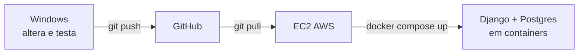

## Django API com Docker + PostgreSQL

## Objetivo

Continuar o roteiro [13 - djangosqlitedocker.md](./13%20-%20djangosqlitedocker.md) trocando o SQLite pelo PostgreSQL, também em container. Só são alterados 4 arquivos: `requirements.txt`, `config/settings.py`, `docker-compose.yml` e `.env`.

Resultado: `http://localhost:8000/api/tarefas/` funcionando com os dados gravados no Postgres, localmente e na EC2.

## Pré-requisitos

- Projeto `minha-api` do roteiro anterior funcionando no Windows, já versionado no GitHub e implantado na EC2
- Docker Desktop no Windows; Docker, Docker Compose e Git na EC2

## Fluxo de trabalho

| Etapa | Onde | O que fazer |
|---|---|---|
| 1. Desenvolver | **Windows** | Partes 1 a 3: alterar os arquivos, subir o Docker e testar localmente |
| 2. Versionar | **Windows → GitHub** | Parte 4: `git commit` e `git push` |
| 3. Sincronizar | **GitHub → EC2** | Parte 5: `git pull` na EC2 |
| 4. Deploy | **EC2 (Docker)** | Parte 6: criar o `.env`, `docker compose up -d --build` e testar pelo IP público |



Regra: o código é alterado **somente no Windows**. A EC2 apenas recebe as mudanças via Git e executa o deploy. A única exceção é o `.env`, que contém a senha e por isso **não vai para o GitHub**: ele é criado manualmente em cada máquina.

---

## Parte 1 - Alterar o projeto (Windows)

Na pasta `minha-api`, com o ambiente antigo parado:

```bash
docker compose down
```

### 1.1 `requirements.txt`

Adicione uma linha ao final do arquivo:

```
psycopg[binary]
```

### 1.2 `config/settings.py`

Substitua o bloco `DATABASES` (o `import os` já existe):

```python
DATABASES = {
    "default": {
        "ENGINE": "django.db.backends.postgresql",
        "NAME": os.environ.get("POSTGRES_DB", "tarefas"),
        "USER": os.environ.get("POSTGRES_USER", "postgres"),
        "PASSWORD": os.environ.get("POSTGRES_PASSWORD", "postgres"),
        "HOST": os.environ.get("POSTGRES_HOST", "db"),
        "PORT": os.environ.get("POSTGRES_PORT", "5432"),
    }
}
```

### 1.3 `.env` (novo arquivo, na raiz do projeto)

```
POSTGRES_DB=tarefas
POSTGRES_USER=postgres
POSTGRES_PASSWORD=troque_esta_senha
```

Adicione `.env` ao `.gitignore` **antes** do primeiro commit, para não enviar a senha ao GitHub:

```
.env
```

### 1.4 `docker-compose.yml`

Substitua todo o conteúdo:

```yaml
services:
  db:
    image: postgres:16
    env_file: .env
    volumes:
      - pgdata:/var/lib/postgresql/data
    healthcheck:
      test: ["CMD-SHELL", "pg_isready -U $${POSTGRES_USER} -d $${POSTGRES_DB}"]
      interval: 3s
      timeout: 3s
      retries: 10

  web:
    build: .
    env_file: .env
    environment:
      POSTGRES_HOST: db
    ports:
      - "8000:8000"
    depends_on:
      db:
        condition: service_healthy

volumes:
  pgdata:
```

- `db`: container do PostgreSQL; os dados ficam no volume `pgdata`.
- `env_file`: carrega o `.env` dentro do container.
- `healthcheck` + `depends_on`: o `web` só inicia (e roda o `migrate`) depois que o banco estiver pronto.
- `POSTGRES_HOST: db`: o nome do serviço funciona como hostname na rede do Compose.
- O `Dockerfile` **não muda**.

---

## Parte 2 - Executar e testar localmente (Windows)

Execute no PowerShell, na pasta `minha-api`, com o Docker Desktop em execução. Só avance para a Parte 4 depois que a API responder corretamente aqui.

```bash
docker compose up -d --build
docker compose logs -f web
```

`Ctrl+C` para de acompanhar os logs; os containers continuam em execução.

```bash
curl.exe http://localhost:8000/api/tarefas/
curl.exe -X POST http://localhost:8000/api/tarefas/ -H "Content-Type: application/json" -d "{\"titulo\":\"Estudar Postgres\"}"
curl.exe http://localhost:8000/api/tarefas/
```

---

## Parte 3 - Conferir o banco e a persistência (Windows / Docker)

### Confirmar que os dados estão no Postgres

```bash
docker compose exec db sh -c 'psql -U $POSTGRES_USER -d $POSTGRES_DB -c "SELECT * FROM tarefas_tarefa;"'
```

### Testar a persistência

```bash
docker compose down
docker compose up -d
curl.exe http://localhost:8000/api/tarefas/
```

A tarefa deve continuar na lista. Evite `docker compose down -v`: ele apaga o volume `pgdata`.

Ao terminar, pare o ambiente local com `docker compose down`.

---

## Parte 4 - Sincronizar com o GitHub (Windows → GitHub)

No PowerShell, na pasta `minha-api`:

```powershell
git status
git add .
git commit -m "Troca SQLite por PostgreSQL"
git push
```

Confira no `git status` que o `.env` **não** aparece na lista. No GitHub, verifique que `docker-compose.yml`, `requirements.txt` e `config/settings.py` foram atualizados e que `.env` não foi enviado.

---

## Parte 5 - Sincronizar com a EC2 (GitHub → EC2)

Conecte-se à EC2 pelo terminal do VS Code ou do Windows:

```powershell
ssh -i caminho\chave.pem ec2-user@<IP_PUBLICO_EC2>
```

Na **EC2**, atualize o código:

```bash
cd <repositorio>
git pull
```

A porta `5432` **não** deve ser liberada no Security Group nem publicada no Compose: só o container `web` acessa o banco. A porta `8000` continua liberada como antes.

---

## Parte 6 - Deploy com Docker (EC2)

Execute na **EC2**, na pasta do projeto.

### 6.1 Criar o `.env` (somente na primeira vez)

```bash
nano .env
```

```
POSTGRES_DB=tarefas
POSTGRES_USER=postgres
POSTGRES_PASSWORD=<senha_forte_da_ec2>
```

Use uma senha diferente da usada no Windows.

### 6.2 Subir os containers

Se o ambiente SQLite antigo ainda estiver rodando, pare-o primeiro (o volume `sqlitedata` antigo pode ser mantido ou removido depois):

```bash
docker compose down
docker compose up -d --build
docker compose ps
docker compose logs -f web
```

### 6.3 Testar

De qualquer máquina (inclusive o Windows):

```powershell
curl.exe http://<IP_PUBLICO_EC2>:8000/api/tarefas/
```

O banco da EC2 começa vazio: os dados do Windows e do SQLite antigo **não** são migrados.

### Ciclo de atualização

1. **Windows**: altere o código, teste com `docker compose up -d --build` e execute `git push`.
2. **EC2**: execute `git pull`.
3. **EC2**: execute `docker compose up -d --build`.

Os dados ficam no volume `pgdata` de cada máquina; não use `down -v` na EC2 se quiser preservá-los.

---

## Comandos úteis

| Ação | Onde | Comando |
|---|---|---|
| Ver containers | Windows / EC2 | `docker compose ps` |
| Logs da API | Windows / EC2 | `docker compose logs -f web` |
| Logs do banco | Windows / EC2 | `docker compose logs -f db` |
| Shell do Postgres | Windows / EC2 | `docker compose exec db sh -c 'psql -U $POSTGRES_USER -d $POSTGRES_DB'` |
| Parar | Windows / EC2 | `docker compose down` |
| Parar e **apagar dados** | Windows / EC2 | `docker compose down -v` |

## Problemas comuns

- **`could not translate host name "db"`**: o `POSTGRES_HOST` não é `db` ou o serviço `db` não está no Compose.
- **`password authentication failed`**: o volume `pgdata` já foi criado com outra senha. Em ambiente de teste, rode `docker compose down -v` e suba de novo.
- **`ModuleNotFoundError: psycopg`**: faltou `psycopg[binary]` no `requirements.txt`; rode `docker compose up -d --build`.
- **`env file .env not found` na EC2**: o `.env` não vai pelo GitHub; crie-o conforme a Parte 6.1.
- **Dados antigos do SQLite**: não são migrados; o Postgres começa vazio.
