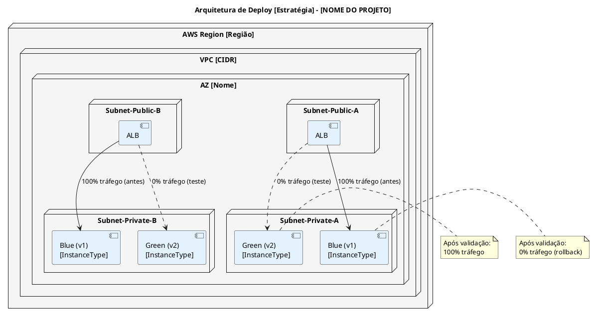
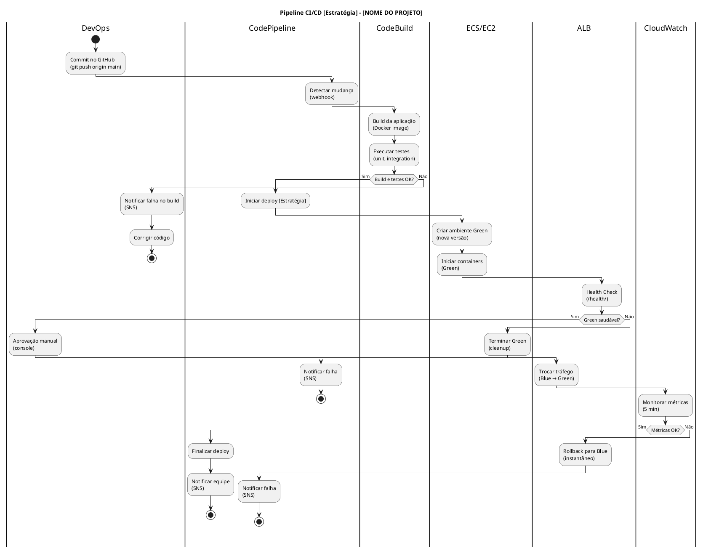
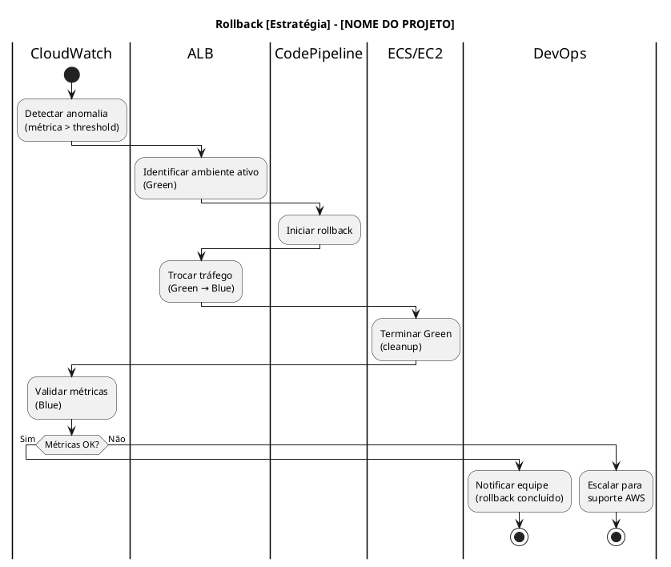
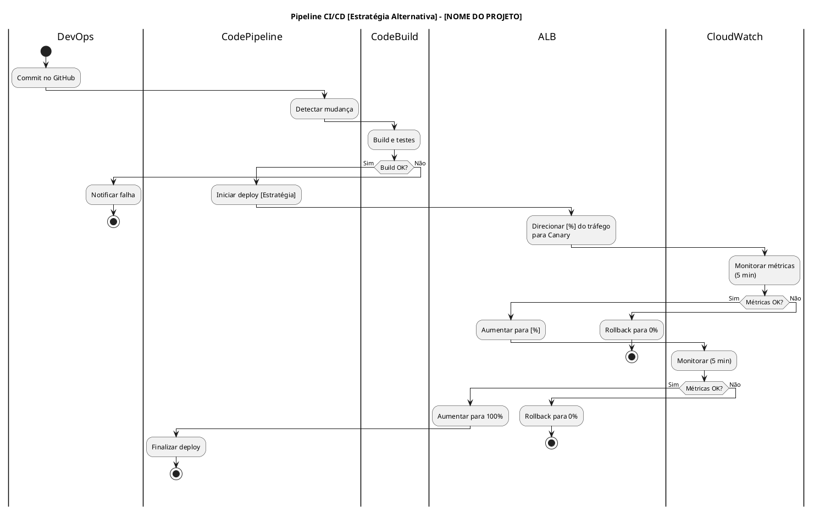
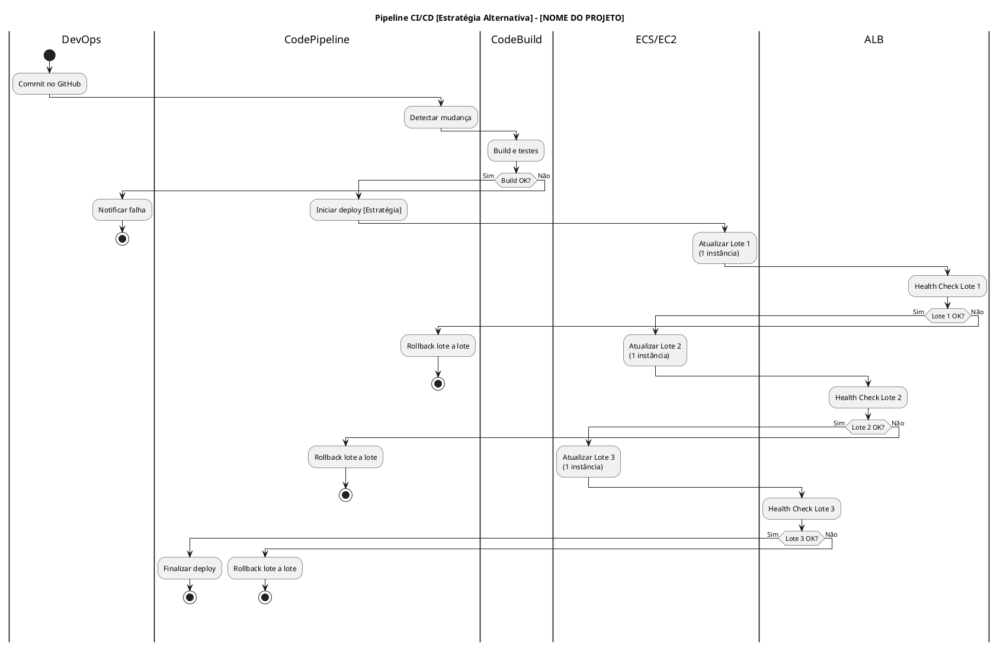
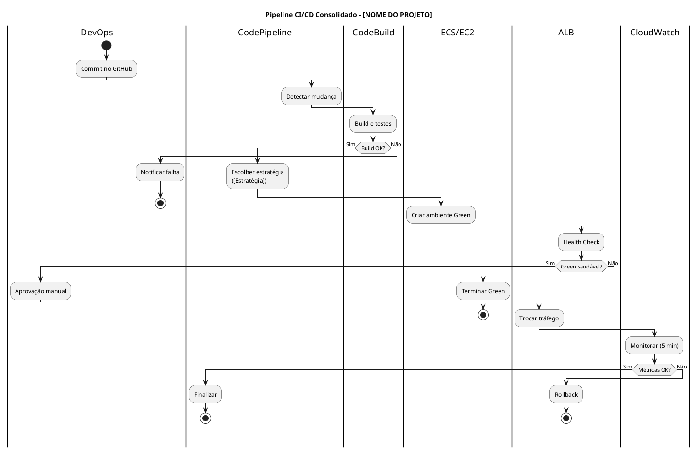

# MODELO DE DESIGN (DIAGRAMAS DE ATIVIDADES)

## ESTRATÉGIAS DE DEPLOY

## [NOME DO PROJETO] - [DESCRIÇÃO CURTA DO PROJETO]

---

| **Informação do Documento** | |
| :--- | :--- |
| **Projeto** | [Nome do Projeto] |
| **Documento** | Modelo de Design (Diagramas de Atividades) - Estratégias de Deploy |
| **Versão** | 1.0 |
| **Data** | [DD/MM/AAAA] |
| **Status** | Em Desenvolvimento |
| **Responsável** | [Nome do Grupo] |
| **Disciplina** | Projeto de Cloud - Semana 10 |
| **Fase RUP/UP** | Construction |

---

## 1. INTRODUÇÃO

### 1.1. Propósito

Este documento apresenta o **Modelo de Design (Diagramas de Atividades)** para as **Estratégias de Deploy** da plataforma **[NOME DO PROJETO]** na AWS. O modelo demonstra o fluxo completo do pipeline de CI/CD (Build → Test → Deploy → Validation → Rollback), comparando as estratégias **Blue-Green**, **Canary** e **Rolling**, e justificando a escolha com base nos requisitos não-funcionais (SLA, RTO, rollback).

O modelo é derivado diretamente dos seguintes artefatos:
- **Documento de Visão** (Semana 1) - Seção "Automação"
- **Documento de Requisitos Suplementares** (Semana 2) - Seções "Manutenibilidade" e "Confiabilidade"
- **Modelo de Casos de Uso Arquiteturais** (Semana 3) - UC-ARQ-XXX (CI/CD Pipeline)
- **Modelo de Análise (Pacotes/Subsistemas)** (Semana 4) - Pacote "[Audit & Compliance]"
- **Modelo de Análise (Classes) - RDS** (Semana 5) - `DatabaseInstance`, `BackupPolicy`
- **Modelo de Análise (Classes) - EC2** (Semana 6) - `ComputeInstance`, `AutoScalingGroup`, `LoadBalancer`
- **Modelo de Design (Sequência/Comunicação)** (Semana 7) - Fluxo de Deploy Automatizado

### 1.2. Escopo

O modelo abrange as **estratégias de deploy** para a camada de computação do projeto, incluindo:
- **Pipeline CI/CD:** Build → Test → Deploy → Validation → Rollback
- **Estratégia Blue-Green:** Ambiente espelho (Green) com troca de tráfego
- **Estratégia Canary:** Liberação gradual (5% → 25% → 50% → 100%)
- **Estratégia Rolling:** Atualização em lotes
- **Validação e Rollback:** Health checks, métricas, reversão automática
- **Estimativas de tempo e custo** por estratégia

**Fora do escopo:** Deploy do banco de dados RDS (tratado na Semana 5) e deploy de funções Lambda (tratado em documento separado, se aplicável).

### 1.3. Definições e Siglas

| **Sigla** | **Definição** |
| :--- | :--- |
| **CI/CD** | Continuous Integration / Continuous Deployment |
| **ALB** | Application Load Balancer |
| **ASG** | Auto Scaling Group |
| **ECS** | Elastic Container Service |
| **ECR** | Elastic Container Registry |
| **RTO** | Recovery Time Objective |
| **RPO** | Recovery Point Objective |
| **SLA** | Service Level Agreement |
| **TPS** | Transactions Per Second |
| **LGPD** | Lei Geral de Proteção de Dados |

### 1.4. Referências

- Documento de Visão - [NOME DO PROJETO] (v1.0)
- Documento de Requisitos Suplementares - [NOME DO PROJETO] (v1.0)
- Modelo de Casos de Uso Arquiteturais - [NOME DO PROJETO] (v1.0)
- Modelo de Análise (Pacotes/Subsistemas) - [NOME DO PROJETO] (v1.0)
- Modelo de Análise (Classes) - RDS - [NOME DO PROJETO] (v1.0)
- Modelo de Análise (Classes) - EC2 - [NOME DO PROJETO] (v1.0)
- Modelo de Design (Sequência/Comunicação) - [NOME DO PROJETO] (v1.0)
- AWS CodePipeline Documentation
- AWS CodeDeploy Documentation
- AWS Well-Architected Framework - Operational Excellence Pillar

---

## 2. VISÃO GERAL DAS ESTRATÉGIAS DE DEPLOY

### 2.1. Requisitos que Impactam o Deploy

| **Requisito** | **Valor** | **Fonte** |
| :--- | :--- | :--- |
| **Disponibilidade** | [Valor] | Requisitos Suplementares |
| **RTO** | [Valor] | Requisitos Suplementares |
| **RPO** | [Valor] | Requisitos Suplementares |
| **Tempo de deploy** | [Valor] | Requisitos Suplementares |
| **Tempo de rollback** | [Valor] | Requisitos Suplementares |
| **Zero downtime** | [Sim/Não] | Requisitos Suplementares |
| **Usuários** | [Valor] | Documento de Visão |
| **TPS (pico)** | [Valor] | Requisitos Suplementares |
| **Orçamento total** | [Valor] | Documento de Visão |
| **Orçamento para deploy** | [Valor] | Estimativa |

### 2.2. Comparação das Estratégias de Deploy

| **Critério** | **Rolling** | **Blue-Green** | **Canary** |
| :--- | :--- | :--- | :--- |
| **Custo** | [Avaliação] | [Avaliação] | [Avaliação] |
| **Complexidade** | [Avaliação] | [Avaliação] | [Avaliação] |
| **Risco** | [Avaliação] | [Avaliação] | [Avaliação] |
| **Tempo de Rollback** | [Avaliação] | [Avaliação] | [Avaliação] |
| **Zero Downtime** | [Avaliação] | [Avaliação] | [Avaliação] |
| **Detecção de Erros** | [Avaliação] | [Avaliação] | [Avaliação] |
| **Adequação ao SLA** | [Avaliação] | [Avaliação] | [Avaliação] |
| **Adequação ao RTO** | [Avaliação] | [Avaliação] | [Avaliação] |
| **Escolha para [PROJETO]** | [✅/❌] | [✅/❌] | [✅/❌] |

### 2.3. Arquitetura de Deploy

---

## 3. ESPECIFICAÇÃO DAS ESTRATÉGIAS

---

### 3.1. ESTRATÉGIA ESCOLHIDA: [BLUE-GREEN / CANARY / ROLLING]

#### 3.1.1. Descrição

[Descrever a estratégia escolhida em detalhes: como funciona, quais são os passos, qual o objetivo.]

**Exemplo:** A estratégia **Blue-Green** cria um ambiente espelho (Green) com a nova versão da aplicação, testa exaustivamente e, após validação, troca o tráfego do ambiente antigo (Blue) para o novo (Green). Em caso de falha, o rollback é instantâneo (troca de volta para Blue).

#### 3.1.2. Justificativa da Escolha

| **Requisito** | **Valor** | **[Estratégia] Atende?** | **Justificativa** |
| :--- | :--- | :--- | :--- |
| **SLA** | [Valor] | [✅/❌/⚠️] | [Justificativa] |
| **RTO** | [Valor] | [✅/❌/⚠️] | [Justificativa] |
| **Rollback** | [Valor] | [✅/❌/⚠️] | [Justificativa] |
| **Deploy** | [Valor] | [✅/❌/⚠️] | [Justificativa] |
| **Custo** | [Valor] | [✅/❌/⚠️] | [Justificativa] |

#### 3.1.3. Diagrama de Atividades - Pipeline [Estratégia]

#### 3.1.4. Diagrama de Atividades - Rollback

#### 3.1.5. Tabela de Atividades

| **#** | **Swimlane** | **Atividade** | **Descrição** | **Tempo** | **Custo** |
| :--- | :--- | :--- | :--- | :--- | :--- |
| 1 | DevOps | Commit no GitHub | Push do código. | [Tempo] | [Custo] |
| 2 | CodePipeline | Detectar mudança | Webhook do GitHub. | [Tempo] | [Custo] |
| 3 | CodeBuild | Build da aplicação | Docker build. | [Tempo] | [Custo] |
| 4 | CodeBuild | Executar testes | Unit + integration. | [Tempo] | [Custo] |
| 5 | CodePipeline | Iniciar deploy | Orquestração. | [Tempo] | [Custo] |
| 6 | ECS/EC2 | Criar ambiente Green | Nova versão. | [Tempo] | [Custo] |
| 7 | ALB | Health Check | `/health/`. | [Tempo] | [Custo] |
| 8 | DevOps | Aprovação manual | Console. | [Tempo] | [Custo] |
| 9 | ALB | Trocar tráfego | Blue → Green. | [Tempo] | [Custo] |
| 10 | CloudWatch | Monitorar métricas | 5 min. | [Tempo] | [Custo] |
| 11 | CodePipeline | Finalizar deploy | Notificar. | [Tempo] | [Custo] |
| **Total** | | | | **[Total]** | **[Total]** |

#### 3.1.6. Riscos e Mitigações

| **Risco** | **Probabilidade** | **Impacto** | **Mitigação** |
| :--- | :--- | :--- | :--- |
| [Risco 1] | [Alta/Média/Baixa] | [Alto/Médio/Baixo] | [Mitigação] |
| [Risco 2] | [Alta/Média/Baixa] | [Alto/Médio/Baixo] | [Mitigação] |
| [Risco 3] | [Alta/Média/Baixa] | [Alto/Médio/Baixo] | [Mitigação] |

---

### 3.2. ESTRATÉGIA ALTERNATIVA 1: [CANARY / ROLLING]

#### 3.2.1. Descrição

[Descrever a estratégia alternativa.]

#### 3.2.2. Diagrama de Atividades - Pipeline [Estratégia Alternativa]

#### 3.2.3. Comparação [Estratégia Escolhida] vs [Estratégia Alternativa]

| **Critério** | **[Estratégia Escolhida]** | **[Estratégia Alternativa]** |
| :--- | :--- | :--- |
| **Complexidade** | [Avaliação] | [Avaliação] |
| **Custo** | [Avaliação] | [Avaliação] |
| **Detecção de erros** | [Avaliação] | [Avaliação] |
| **Rollback** | [Avaliação] | [Avaliação] |
| **Adequação ao SLA** | [Avaliação] | [Avaliação] |

**Conclusão:** [Justificar por que a estratégia escolhida é melhor.]

---

### 3.3. ESTRATÉGIA ALTERNATIVA 2: [ROLLING / BLUE-GREEN]

#### 3.3.1. Descrição

[Descrever a estratégia alternativa.]

#### 3.3.2. Diagrama de Atividades - Pipeline [Estratégia Alternativa]

#### 3.3.3. Comparação [Estratégia Escolhida] vs [Estratégia Alternativa]

| **Critério** | **[Estratégia Escolhida]** | **[Estratégia Alternativa]** |
| :--- | :--- | :--- |
| **Complexidade** | [Avaliação] | [Avaliação] |
| **Custo** | [Avaliação] | [Avaliação] |
| **Rollback** | [Avaliação] | [Avaliação] |
| **Zero downtime** | [Avaliação] | [Avaliação] |
| **Adequação ao SLA** | [Avaliação] | [Avaliação] |

**Conclusão:** [Justificar por que a estratégia escolhida é melhor.]

---

## 4. DIAGRAMA DE ATIVIDADES CONSOLIDADO

---

## 5. MATRIZ DE RASTREAMENTO

| **Requisito (Doc. Suplementar)** | **Caso de Uso (Semana 3)** | **Pacote (Semana 4)** | **Classe (Semana 5/6)** | **Estratégia** | **Diagrama** |
| :--- | :--- | :--- | :--- | :--- | :--- |
| [Requisito 1] | [UC-ARQ-XXX] | [Pacote] | [Classe] | [Estratégia] | [Diagrama] |
| [Requisito 2] | [UC-ARQ-XXX] | [Pacote] | [Classe] | [Estratégia] | [Diagrama] |
| [Requisito 3] | [UC-ARQ-XXX] | [Pacote] | [Classe] | [Estratégia] | [Diagrama] |
| [Requisito 4] | [UC-ARQ-XXX] | [Pacote] | [Classe] | [Estratégia] | [Diagrama] |
| [Requisito 5] | [UC-ARQ-XXX] | [Pacote] | [Classe] | [Estratégia] | [Diagrama] |

---

## 6. ESTIMATIVAS DE TEMPO E CUSTO

### 6.1. [Estratégia Escolhida]

| **Etapa** | **Tempo** | **Custo** |
| :--- | :--- | :--- |
| Build + Testes | [Tempo] | [Custo] |
| Criar Green | [Tempo] | [Custo] |
| Health Check | [Tempo] | [Custo] |
| Aprovação | [Tempo] | [Custo] |
| Trocar Tráfego | [Tempo] | [Custo] |
| Monitoramento | [Tempo] | [Custo] |
| **Total** | **[Total]** | **[Total]** |

**Nota:** [Se o tempo total estiver acima do requisito, indicar otimizações necessárias.]

### 6.2. [Estratégia Alternativa 1]

| **Etapa** | **Tempo** | **Custo** |
| :--- | :--- | :--- |
| Build + Testes | [Tempo] | [Custo] |
| [Etapa 1] | [Tempo] | [Custo] |
| [Etapa 2] | [Tempo] | [Custo] |
| [Etapa 3] | [Tempo] | [Custo] |
| **Total** | **[Total]** | **[Total]** |

### 6.3. [Estratégia Alternativa 2]

| **Etapa** | **Tempo** | **Custo** |
| :--- | :--- | :--- |
| Build + Testes | [Tempo] | [Custo] |
| [Etapa 1] | [Tempo] | [Custo] |
| [Etapa 2] | [Tempo] | [Custo] |
| [Etapa 3] | [Tempo] | [Custo] |
| **Total** | **[Total]** | **[Total]** |

---

## 7. CONSIDERAÇÕES FINAIS

### 7.1. Lições Aprendidas

- [Lição 1]
- [Lição 2]
- [Lição 3]
- [Lição 4]

### 7.2. Próximos Passos

- **Semana 11:** Gerenciamento de Configurações e Segredos (Secrets Manager, Parameter Store).
- **Semana 12:** Planejamento de Backup e Disaster Recovery (RPO/RTO).
- **Semana 13:** Estimativa de Custos e Otimização (FinOps).

---

## 8. APROVAÇÕES

| **Função** | **Nome** | **Data** | **Assinatura** |
| :--- | :--- | :--- | :--- |
| Arquiteto de Soluções | | | |
| Arquiteto de DevOps | | | |
| Professor Responsável | | | |
| Coordenador do Curso | | | |

---

## 9. HISTÓRICO DE VERSÕES

| **Versão** | **Data** | **Autor** | **Descrição das Alterações** |
| :--- | :--- | :--- | :--- |
| 0.1 | [DD/MM/AAAA] | [Nome do Grupo] | Criação inicial do documento. |
| 1.0 | [DD/MM/AAAA] | [Nome do Grupo] | Versão completa com todas as estratégias. |

---

**FIM DO DOCUMENTO**

---

## INSTRUÇÕES DE PREENCHIMENTO

### Como Utilizar Este Modelo

1. **Substitua os placeholders** `[NOME DO PROJETO]`, `[DD/MM/AAAA]`, `[Nome do Grupo]` pelas informações do seu projeto.

2. **Adapte as estratégias** conforme as necessidades específicas do seu projeto. Nem todos os projetos terão as três estratégias; escolha as que fazem sentido.

3. **Preencha as tabelas de atividades** com os detalhes do seu caso (tempo, custo, responsável).

4. **Utilize os diagramas PlantUML** como base, adaptando as swimlanes e atividades.

5. **Documente os riscos** e mitigações para cada estratégia.

6. **Valide a consistência** com os artefatos das semanas anteriores (Visão, Requisitos, Casos de Uso, Pacotes, Classes, Design).

### Critérios de Avaliação

| **Critério** | **Peso** | **Descrição** |
| :--- | :--- | :--- |
| **Completude das Estratégias** | 25% | Todas as estratégias foram comparadas? |
| **Diagramas PlantUML** | 20% | Os diagramas estão corretos e completos? |
| **Tabelas de Atividades** | 20% | As atividades estão detalhadas e corretas? |
| **Justificativas Técnicas** | 20% | As decisões são bem fundamentadas? |
| **Riscos e Mitigações** | 15% | Os riscos estão identificados e mitigados? |