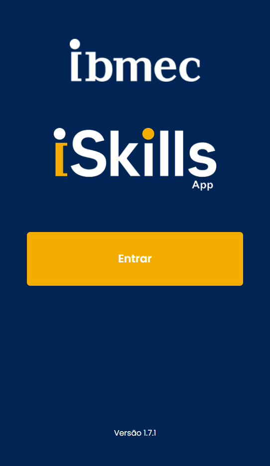

---
hide:
  - navigation
  - toc
  - template: home.html
---

  

    <h1 class="bdcc-title">
      Projeto Cloud Computing
    </h1>
<section class="bdcc-card">
    

    
    

        

      </section>

    

      <section class="bdcc-card">
        <h2 class="bdcc-card__title">Ferramentas</h2>
        

          

            Ambiente:
            Python, Django, Visual Studio Code e GitHub
          

          

            Tecnologias
            AWS - EC2, S3, RDS, Beanstalk, etc.
          

        

      </section>

      <section class="bdcc-card bdcc-card--accent">
        <h2 class="bdcc-card__title">Entrega das atividades</h2>
        
         
          As APs deverão ser enviadas no GitHub.
        

        

        <a href="https://github.com/Projetos-de-Extensao/PC_ADS_26.2_8001_I">Grupo I</a>, <a href="https://github.com/Projetos-de-Extensao/PC_ADS_26.2_8001_II">Grupo II</a>, <a href="https://github.com/Projetos-de-Extensao/PC_ADS_26.2_8001_III">Grupo III</a> e <a href="https://github.com/Projetos-de-Extensao/PC_ADS_26.2_8001_IV">Grupo IV</a>
      </section>
    

  

