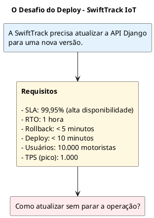
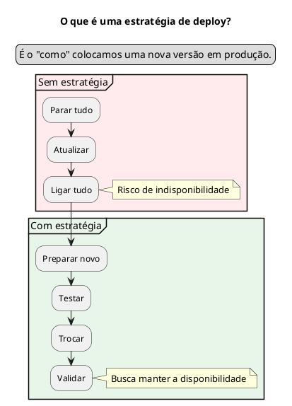
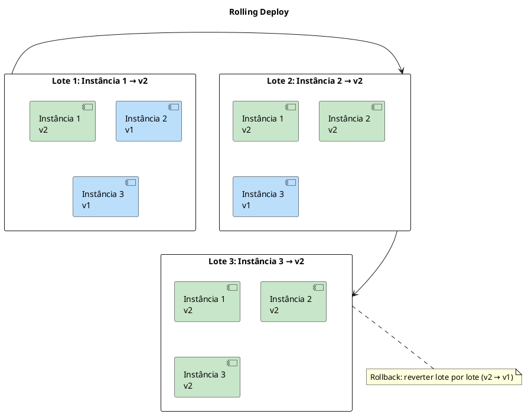
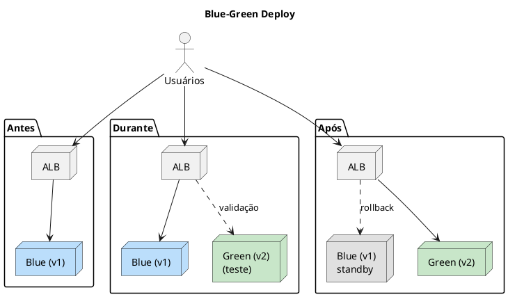
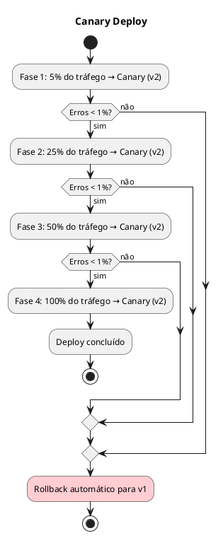

### Teoria: Estratégias de Deploy

### 1.1. Objetivo Geral
Capacitar os alunos a compreender, comparar e selecionar estratégias de deploy (Rolling, Blue-Green, Canary) adequadas ao contexto da SwiftTrack IoT, considerando os requisitos não-funcionais (SLA, RTO, custo) e as restrições orçamentárias do projeto.

### 1.2. Objetivos Específicos
- Compreender o conceito e a importância das estratégias de deploy.
- Diferenciar as estratégias Rolling, Blue-Green e Canary.
- Identificar vantagens, desvantagens e contextos de uso de cada estratégia.
- Relacionar as estratégias aos requisitos não-funcionais da SwiftTrack (SLA 99,95%, RTO 1h, rollback < 5 min).
- Selecionar a estratégia mais adequada para o case SwiftTrack com justificativa técnica.

## 3. Desenvolvimento Detalhado

### 3.1. Abertura e Contextualização

**Tema:** "Por que o deploy é um momento crítico?"

#### 3.1.1. Pergunta de Abertura

> *"Quantos de vocês já viram um sistema ficar fora do ar durante uma atualização? O que aconteceu?"*

**Objetivo:** Engajar os alunos com experiências reais e introduzir a importância do deploy seguro.

**Respostas Esperadas:**
- "O site ficou lento."
- "Perdemos dados."
- "Os usuários reclamaram."
- "Tivemos que reverter manualmente."

#### 3.1.2. Contextualização com a SwiftTrack

**Slide de Abertura:**

**Momento Interativo:**
> *"Se o deploy falhar e a API ficar fora do ar por 1 hora, qual o impacto para a SwiftTrack?"*

**Respostas Esperadas:**
- Motoristas não recebem rotas.
- Operadores não acessam dashboards.
- Faturas não são geradas.
- Perda de receita e reputação.

---

### 3.2. Conceitos Fundamentais de Deploy

**Tema:** "O que é uma estratégia de deploy e por que ela importa?"

#### 3.2.1. Definição 

| **Conceito** | **Definição** |
| :--- | :--- |
| **Deploy** | Processo de colocar uma nova versão da aplicação em produção. |
| **Estratégia de Deploy** | Abordagem que define como versões são introduzidas, disponibilizadas aos usuários e, se necessário, substituídas, controlando risco, impacto e continuidade do serviço. |
| **Zero Downtime** | Objetivo de realizar a transição sem interrupção perceptível do serviço. É uma propriedade do sistema e do processo como um todo, não uma garantia automática de uma estratégia específica. |
| **Rollback** | Retorno operacional à versão anterior, incluindo a reversão do tráfego ou das instâncias. A aplicação pode exigir ações adicionais quando há mudanças incompatíveis em dados ou efeitos externos. |
| **SLA** | Acordo de nível de serviço que estabelece compromissos mensuráveis, como disponibilidade. Um SLA de 99,95% admite uma margem limitada de indisponibilidade no período de medição; não significa, por si só, exigência de zero downtime em cada deploy. |
| **RTO** | Objetivo de tempo de recuperação: prazo máximo definido para restabelecer o serviço após uma interrupção. |

**Slide Ilustrativo:**

#### 3.2.2. Por que as Estratégias são Importantes? (5 min)

| **Motivo** | **Explicação** |
| :--- | :--- |
| **Redução de Risco** | Minimiza a chance de falhas afetarem todos os usuários. |
| **Continuidade do serviço** | Reduz ou evita interrupções percebidas durante o deploy, desde que capacidade, roteamento e dependências estejam preparados. |
| **Rollback Rápido** | Permite reverter rapidamente em caso de problema. |
| **Detecção Precoce** | Identifica problemas antes que afetem todos os usuários. |
| **Conformidade com SLA** | Atende aos requisitos de disponibilidade (99,95%). |

#### 3.2.3. Conexão com os Requisitos da SwiftTrack (5 min)

| **Requisito** | **Valor** | **Como a Estratégia Ajuda** |
| :--- | :--- | :--- |
| **SLA** | 99,95% | Reduzir interrupções e preservar a disponibilidade medida; o orçamento de indisponibilidade deve ser acompanhado. |
| **RTO** | 1 hora | Rollback rápido (< 5 min). |
| **Rollback** | < 5 min | Retorno à versão anterior dentro do objetivo de tempo, sem pressupor reversão instantânea. |
| **Deploy** | < 10 min | Processo otimizado. |
| **Usuários** | 10.000 | Liberação gradual ou ambiente espelho. |

**Momento Interativo:**
> *"Qual desses requisitos vocês consideram mais crítico para a SwiftTrack? Por quê?"*

**Respostas Esperadas:**
- "SLA 99,95%, porque afeta a receita."
- "Rollback < 5 min, porque minimiza o impacto."
- "Deploy < 10 min, porque a equipe precisa ser ágil."

---

### 3.3. Estratégia Rolling

**Tema:** "Atualização em Lotes - Simples e Econômica"

#### 3.3.1. Definição e Funcionamento

| **Aspecto** | **Descrição** |
| :--- | :--- |
| **Definição** | Substitui gradualmente as instâncias ou unidades de execução da versão atual pelas da nova versão, em lotes, sem trocar toda a frota de uma só vez. |
| **Funcionamento** | Um lote é retirado do serviço, atualizado e validado antes do próximo. As unidades ainda não atualizadas continuam atendendo tráfego, desde que haja capacidade e a aplicação tolere a coexistência temporária de versões. |
| **Vantagens** | Simples, sem custo extra. |
| **Desvantagens** | Durante a transição há mistura de versões; rollback pode exigir uma nova atualização lote a lote e a capacidade disponível pode diminuir. |
| **Uso Recomendado** | Atualizações rotineiras, com baixo risco. |

**Fundamentação teórica:** Rolling deployment é uma estratégia de substituição progressiva da frota em produção. Em vez de criar um ambiente completo paralelo, o orquestrador ou pipeline atualiza um subconjunto de instâncias por vez, preservando as demais como capacidade ativa. O tamanho dos lotes e os critérios de prontidão determinam o ritmo e o risco da mudança.

Para manter a continuidade, cada lote deve sair do balanceamento antes de ser atualizado e só voltar a receber tráfego após passar por verificações de saúde. A capacidade restante precisa suportar a carga, e as versões antiga e nova devem ser compatíveis durante a janela de coexistência — inclusive com o esquema do banco de dados e contratos de API. Se uma validação falhar, a progressão é interrompida; a reversão pode ser mais lenta do que uma troca de tráfego porque as instâncias precisam ser restauradas gradualmente.

#### 3.3.2. Slide Ilustrativo - Rolling Deploy (5 min)

**Explicação Passo a Passo:**

| **Passo** | **Ação** | **Estado** |
| :--- | :--- | :--- |
| 1 | Instância 1 é atualizada para v2. | [v2, v1, v1] |
| 2 | Instância 2 é atualizada para v2. | [v2, v2, v1] |
| 3 | Instância 3 é atualizada para v2. | [v2, v2, v2] |

**Rollback:**
- Reverter lote por lote (Instância 1 → v1, Instância 2 → v1, Instância 3 → v1).

#### 3.3.3. Aplicação à SwiftTrack 

| **Aspecto** | **Avaliação para SwiftTrack** |
| :--- | :--- |
| **Vantagens** | Simples, sem custo extra. |
| **Desvantagens** | Rollback lento (~10 min), mistura de versões. |
| **Adequação ao SLA** | ❌ Parcial (pode haver downtime durante o rollback). |
| **Adequação ao RTO** | ⚠️ Parcial (rollback de 10 min é aceitável, mas o risco de mistura de versões é alto). |
| **Adequação ao Custo** | ✅ Sim (sem custo extra). |
| **Conclusão** | ❌ Não recomendado como estratégia principal: a estimativa de rollback (~10 min) excede o objetivo de rollback da SwiftTrack (< 5 min). O SLA de 99,95% não exige, isoladamente, zero downtime; a disponibilidade dependerá também da capacidade e da configuração do rollout. |

**Momento Interativo:**
> *"Alguém já usou Rolling Deploy? Quais foram os desafios?"*

**Respostas Esperadas:**
- "Sim, mas o rollback foi complicado."
- "Tivemos problemas com versões misturadas."
- "Funcionou bem para atualizações pequenas."

---

### 3.4. ESTRATÉGIA BLUE-GREEN 

**Tema:** "Ambiente Espelho - Rollback Rápido"

#### 3.4.1. Definição e Funcionamento 

| **Aspecto** | **Descrição** |
| :--- | :--- |
| **Definição** | Mantém dois ambientes de produção equivalentes: um atende a versão atual (Blue) e o outro recebe a nova versão (Green). Após validação, o ponto de entrada do tráfego é direcionado ao ambiente novo. |
| **Funcionamento** | Green é preparado e validado sem substituir Blue. A troca é feita por um mecanismo de roteamento, como balanceador ou configuração de tráfego. Blue pode ser preservado temporariamente para permitir uma troca de volta. |
| **Vantagens** | Transição controlada e rollback potencialmente rápido por meio da troca de tráfego. |
| **Desvantagens** | Requer capacidade para manter dois ambientes e não reverte automaticamente mudanças incompatíveis de banco de dados ou efeitos externos. |
| **Uso Recomendado** | Atualizações críticas, com SLA alto. |

**Fundamentação teórica:** Blue-Green é uma estratégia de implantação baseada na existência de dois ambientes produtivos equivalentes, mas com apenas um deles recebendo o tráfego normal por vez. A nova versão é instalada no ambiente inativo, validada e, quando aprovada, promovida por uma mudança de roteamento. A unidade de promoção é o ambiente inteiro, diferentemente de Rolling, que substitui instâncias em lotes.

A troca de tráfego pode ser rápida, mas não torna o rollback necessariamente instantâneo nem garante zero downtime: o resultado depende da propagação da configuração, dos health checks, da conexão dos clientes e da capacidade do ambiente de destino. O ambiente anterior só é um rollback seguro se continuar operacional e se os dados e integrações permanecerem compatíveis após a promoção da nova versão. Migrações aditivas e compatíveis, além de validações antes da troca, reduzem esse risco.

#### 3.4.2. Slide Ilustrativo - Blue-Green Deploy 

**Explicação Passo a Passo:**

| **Passo** | **Ação** | **Estado** |
| :--- | :--- | :--- |
| 1 | Ambiente Blue (v1) está ativo. | [Blue: v1, Green: -] |
| 2 | Ambiente Green (v2) é criado e testado. | [Blue: v1, Green: v2] |
| 3 | Tráfego é trocado para Green. | [Blue: v1, Green: v2 (ativo)] |
| 4 | Blue é mantido para rollback. | [Blue: v1 (standby), Green: v2 (ativo)] |

**Rollback:**
- Direcionar o tráfego novamente para Blue; a rapidez depende do roteamento e da compatibilidade dos dados.

#### 3.4.3. Aplicação à SwiftTrack

| **Aspecto** | **Avaliação para SwiftTrack** |
| :--- | :--- |
| **Vantagens** | Troca de tráfego e retorno potencialmente rápidos, com interrupção mínima quando o roteamento e os health checks estão corretamente configurados. |
| **Desvantagens** | Custo dobrado durante o deploy (~$50/deploy). |
| **Adequação ao SLA** | ✅ Alta, condicionada à capacidade, à saúde do ambiente Green e à compatibilidade dos dados. |
| **Adequação ao RTO** | ✅ Alta (rollback < 1 min). |
| **Adequação ao Custo** | ⚠️ Médio (~$50/deploy, aceitável). |
| **Conclusão** | ✅ Recomendado para a SwiftTrack: combina transição controlada com possibilidade de retorno rápido, alinhando-se ao objetivo de rollback < 5 min. A estratégia contribui para o SLA, mas não o garante sozinha. |

**Momento Interativo:**
> *"O custo dobrado do Blue-Green é justificado para a SwiftTrack? Por quê?"*

**Respostas Esperadas:**
- "Sim, porque o SLA é 99,95%."
- "Sim, porque permite retornar ao ambiente anterior rapidamente."
- "Depende do orçamento, mas vale a pena."

### 3.5. ESTRATÉGIA CANARY 

**Tema:** "Liberação Gradual - Detecção Precoce"

#### 3.5.1. Definição e Funcionamento 

| **Aspecto** | **Descrição** |
| :--- | :--- |
| **Definição** | Expõe a nova versão inicialmente a uma parcela limitada e representativa do tráfego ou dos usuários, ampliando a exposição conforme evidências operacionais. |
| **Funcionamento** | A versão canary recebe uma fração controlada do tráfego. Em etapas, métricas da nova versão são comparadas com critérios definidos e, idealmente, com a versão estável; a exposição é ampliada, interrompida ou revertida conforme os resultados. |
| **Vantagens** | Limita inicialmente o alcance de uma falha e permite observar o comportamento da nova versão sob tráfego real. |
| **Desvantagens** | Exige roteamento seletivo, observabilidade, critérios de decisão e atenção a vieses da amostra e à consistência entre versões. |
| **Uso Recomendado** | Atualizações de alto risco. |

**Fundamentação teórica:** Canary deployment é uma forma de liberação progressiva orientada por evidências. Uma parcela pequena — mas representativa — do tráfego é direcionada à nova versão enquanto a versão estável continua atendendo os demais usuários. A exposição é ampliada em etapas somente quando indicadores previamente escolhidos permanecem dentro dos limites aceitáveis.

Os indicadores podem incluir taxa de erros, latência, saturação de recursos e resultados de negócio. A decisão de avançar ou interromper pode ser manual ou automatizada; em ambos os casos, são necessários um período mínimo de observação, uma linha de base para comparação e limites de alerta explícitos. A amostra precisa representar os padrões de uso relevantes: uma fração pequena demais ou concentrada em usuários atípicos pode não revelar problemas. Canary reduz o impacto potencial e melhora a detecção, mas não elimina falhas nem torna o rollback instantâneo.

#### 3.5.2. Slide Ilustrativo - Canary Deploy 

**Explicação Passo a Passo:**

| **Fase** | **Tráfego para Canary** | **Métrica** | **Decisão** |
| :--- | :--- | :--- | :--- |
| 1 | 5% | Erros < 1% | Avançar |
| 2 | 25% | Erros < 1% | Avançar |
| 3 | 50% | Erros < 1% | Avançar |
| 4 | 100% | Erros < 1% | Concluir |

**Rollback:**
- Reverter para v1 (100% do tráfego).

#### 3.5.3. Aplicação à SwiftTrack 
| **Aspecto** | **Avaliação para SwiftTrack** |
| :--- | :--- |
| **Vantagens** | Detecção precoce, baixo risco. |
| **Desvantagens** | Complexidade, precisa de métricas. |
| **Adequação ao SLA** | Alta em potencial; depende da qualidade das métricas, da representatividade da amostra e da rapidez de interrupção ou reversão. |
| **Adequação ao RTO** |  Média (rollback de 5 min). |
| **Adequação ao Custo** |  Médio (~$20/deploy). |
| **Conclusão** | Não recomendado como primeira opção para a SwiftTrack, considerando a complexidade operacional e a necessidade de métricas e automação maduras; pode ser adequado se a equipe desenvolver esses controles. |

**Momento Interativo:**
> *"O Canary é mais complexo que o Blue-Green. Vale a pena para a SwiftTrack?"*

**Respostas Esperadas:**
- "Não, porque o time é pequeno."
- "Sim, porque detecta erros cedo."
- "Depende do risco das atualizações."

---

### 3.6. Comparação Consolidada

**Tema:** "Qual Estratégia Escolher?"

#### 3.6.1. Tabela Comparativa 

| **Critério** | **Rolling** | **Blue-Green** | **Canary** |
| :--- | :--- | :--- | :--- |
| **Custo** | Baixo (~$0) | Alto (~$50/deploy) | Médio (~$20/deploy) |
| **Complexidade** | Baixa | Média | Alta |
| **Risco** | Médio | Baixo | Muito Baixo |
| **Tempo de Rollback** | 10 min | < 1 min | 5 min |
| **Continuidade durante o deploy** | Depende de capacidade e compatibilidade | Potencialmente alta, com roteamento e health checks adequados | Potencialmente alta, com roteamento e monitoramento adequados |
| **Detecção de Erros** | Tardia | Média | Precoce |
| **Adequação ao SLA 99,95%** | ❌ Parcial | ✅ Alta, condicionada | ✅ Alta, condicionada |
| **Adequação ao RTO 1h** | ⚠️ Parcial | ✅ Alta | ⚠️ Média |
| **Escolha para SwiftTrack** | ❌ | ✅ | ❌ |

#### 3.6.2. Matriz de Decisão (5 min)

| **Se o requisito for...** | **Escolha...** | **Porque...** |
| :--- | :--- | :--- |
| **SLA muito alto (99,99%)** | Blue-Green | Pode permitir retorno rápido, se roteamento e dados forem compatíveis. |
| **Detecção precoce de erros** | Canary | Liberação gradual. |
| **Orçamento limitado** | Rolling | Sem custo extra. |
| **Atualizações críticas** | Blue-Green | Transição controlada e possibilidade de retorno rápido, com as dependências preparadas. |
| **Atualizações rotineiras** | Rolling | Simples e barato. |
| **Alto risco** | Canary | Detecção precoce. |

**Momento Interativo:**
> *"Para a SwiftTrack, qual estratégia vocês escolheriam? Por quê?"*

**Respostas Esperadas:**
- "Blue-Green, porque atende ao SLA 99,95%."
- "Blue-Green, porque permite retornar ao ambiente anterior rapidamente."
- "Canary, porque detecta erros cedo."
- "Rolling, porque é mais barato."
